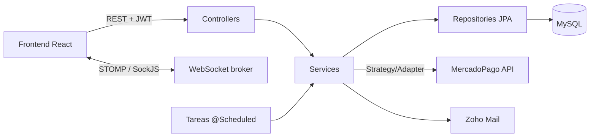

# Wevently · Backend


API REST de **Wevently**, una plataforma para organizar eventos que conecta a tres tipos de usuarios:

- **Organizadores**: crean eventos, reservan lugares y contratan servicios.
- **Propietarios**: publican lugares (salones, quintas, etc.).
- **Prestadores**: ofrecen servicios (catering, DJ, fotografía...) y negocian por chat con el organizador.

Los pagos se procesan con **MercadoPago**, el chat y las notificaciones funcionan en **tiempo real** y el sistema incluye reportes, auditoría de cambios y backups programados de la base de datos.

> Proyecto final de la carrera **Ingeniería en Sistemas – UTN Facultad Regional Mendoza**, desarrollado en equipo.
> Frontend: [wevently-frontend](https://github.com/alear123/wevently-frontend)

---

## Funcionalidades principales

| Módulo | Qué resuelve |
|---|---|
| **Usuarios y Seguridad** | Registro, login con JWT, perfil, roles y permisos, recuperación de contraseña por email (código de verificación vía Zoho Mail), datos bancarios. |
| **Eventos** | ABM de eventos, tipos y estados de evento, reservas de lugares/servicios y reseñas. Una tarea programada marca como *realizados* los eventos vencidos. |
| **Lugares** | ABM de lugares, búsqueda con filtros, disponibilidad y detalle. |
| **Servicios** | ABM de servicios, búsqueda, chat organizador ↔ prestador con propuestas de precio. |
| **Pagos** | Pago de reservas con MercadoPago, comisiones configurables, facturas A/B en PDF y auditoría de transacciones. |
| **Reportes** | Usuarios activos, vistas por lugar/servicio, solicitudes por lugar, servicios más solicitados, historial de eventos. |
| **Backups** | Backups programados (diario/semanal/mensual) con `mysqldump`, retención automática y restauración asíncrona. |
| **Auditoría** | Historial de cambios de las entidades con Hibernate Envers. |

---

## Stack

- **Java 21** + **Spring Boot 3.1.5** (Web, Data JPA, Security, Validation, WebSocket, Scheduling, Async)
- **Hibernate / JPA** + **Spring Data Envers** (auditoría)
- **MySQL** (desarrollo) · **PostgreSQL** (soportado como alternativa)
- **JWT** (JJWT 0.11.5) + **BCrypt** para contraseñas
- **WebSocket + STOMP** (SockJS) para chat y notificaciones
- **MercadoPago** API · **Apache PDFBox** (facturas) · **Zoho Mail** (emails)
- **Lombok**, **spring-dotenv** · **Docker** (build multi-stage)

---

## Arquitectura

El código está organizado **por dominio** (un paquete por módulo de negocio) y, dentro de cada uno, **en capas**:

```
com.wevently.wevently
├── Base/                 # BaseEntity, BaseService y BaseController genéricos + excepciones
├── UsuariosySeguridad/   # JWT, usuarios, roles, permisos, notificaciones, WebSocket
├── Eventos/              # eventos, reservas, reseñas
├── Lugares/
├── Servicios/            # incluye el chat en tiempo real
├── Pagos/                # integración MercadoPago, facturación, comisiones
├── Reportes/
├── Backups/
├── Imagenes/
└── Auditorias/           # configuración de Envers
```

Cada módulo sigue la misma estructura: `Controllers → Services → Repository → Entities`, con `DTO` para la entrada/salida de la API.



**Decisiones de diseño destacables**

- **Base genérica** (`BaseService<E, ID, R>` / `BaseController`): CRUD y baja lógica reutilizables para todas las entidades.
- **Pagos desacoplados del proveedor**: `PaymentProviderStrategy` (Strategy) + `MercadoPagoAdaptador` (Adapter) + `FactoriaPayment`, así se podría sumar otro proveedor sin tocar la lógica de negocio.
- **Autenticación stateless**: `JwtFilter` valida el token en cada request y carga el usuario en el `SecurityContext`; los endpoints se protegen con `@PreAuthorize("isAuthenticated()")`.
- **Tareas programadas** (`@Scheduled`): ejecución de backups pendientes (1 AM), limpieza por retención (2 AM) y actualización de eventos realizados.
- **Procesos pesados en segundo plano** (`@Async` con un `ThreadPoolTaskExecutor` propio): la restauración de backups no bloquea la request y avisa al usuario por notificación.

---

## Mi participación

Trabajé como desarrollador full stack (backend + frontend) en:

- **Login y registro**: endpoints `/api/seguridad/usuarios/login` y `/registrarse`, generación de JWT y hash de contraseñas con BCrypt.
- **ABM completo de Eventos**: crear, listar, editar y cancelar eventos; consulta del lugar y los servicios contratados para cada evento (`EventosController`, `EventoService`).
- **Flujo de reserva**: desde el detalle de un lugar/servicio hasta el formulario de reserva, armando los datos que llegan a la pantalla de pago (`ReservaController`, `ReservaService`).
- **Módulo de Backups**: configuraciones con frecuencia y días de retención, ejecución programada con `mysqldump`, limpieza automática y restauración asíncrona (`BackupsService`).

---

## Cómo correrlo

### Requisitos

- JDK 21 o superior
- MySQL 8+ (y sus binarios `mysqldump`/`mysql` si vas a usar backups)
- Maven (o el wrapper incluido `./mvnw`)

### Pasos

```bash
git clone https://github.com/alear123/wevently-backend.git
cd wevently-backend

# 1. Crear la base de datos
mysql -u root -p -e "CREATE DATABASE wevently;"

# 2. Configurar variables de entorno
cp .env.example .env   # y completar los valores

# 3. Levantar la API (Hibernate crea/actualiza las tablas)
./mvnw spring-boot:run
```

La API queda en `http://localhost:8080/api`.

### Variables de entorno

Se leen desde `.env` (ver [`.env.example`](.env.example)). Las principales:

| Variable | Descripción |
|---|---|
| `DB_URL`, `DB_USERNAME`, `DB_PASSWORD` | Conexión a MySQL |
| `MYSQL_DATABASE`, `BACKUP_DIRECTORY`, `MYSQL_BIN_DIR` | Configuración de backups |
| `JWT_SECRET` | Clave para firmar los tokens (mínimo 32 caracteres) |
| `MERCADOPAGO_ACCESS_TOKEN` | Access token de MercadoPago (usar uno `TEST-` para sandbox) |
| `ZOHO_MAIL_*` | Credenciales OAuth para el envío de emails |

### Con Docker

```bash
docker build -t wevently-backend .
docker run -p 8080:8080 --env-file .env wevently-backend
```

---

## Endpoints principales

| Método | Ruta | Descripción |
|---|---|---|
| `POST` | `/api/seguridad/usuarios/registrarse` | Registro de usuario |
| `POST` | `/api/seguridad/usuarios/login` | Login, devuelve JWT |
| `POST` | `/api/seguridad/usuarios/recuperar` | Envía código de recuperación por email |
| `GET` | `/api/eventos/mis-eventos` | Eventos del usuario autenticado |
| `POST` | `/api/eventos/nuevo` | Crear evento |
| `PUT` | `/api/eventos/editar/{id}` | Editar evento |
| `PUT` | `/api/eventos/cancelar/{id}` | Cancelar evento |
| `GET` | `/api/reservas/datosFormularioReserva/{id}` | Datos para el formulario de reserva |
| `PUT` | `/api/reservas/reservaAPagar` | Confirma datos de la reserva y la deja lista para pagar |
| `GET` | `/api/backups/mis-backups` | Listar configuraciones de backup |
| `POST` | `/api/backups/create` | Crear configuración de backup |
| `POST` | `/api/backups/restaurar/{id}` | Restaurar un backup (asíncrono) |

Las rutas protegidas requieren el header `Authorization: Bearer <token>`.

**WebSocket (STOMP sobre SockJS):** `/ws-notifications` y `/ws-chat` · broker en `/topic` y `/user`.

---

## Equipo

Alejandro Arce · Enzo Silva · Iván Duga · Marcio Palazzo · Cristian Rosales
